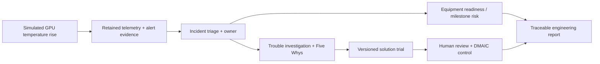

# AI_Infra — AI Infrastructure Operations & Reliability

**Engineering software portfolio** · .NET 10 · Blazor · C# · PostgreSQL · Docker

AI_Infra is a functional software prototype exploring **how compute telemetry becomes reliable operational decisions**. It connects equipment health to incident evidence, engineering ownership, program-readiness risk, investigated problems, and reusable corrective knowledge.

> **Independent, AI-assisted engineering project.** All demonstrated compute equipment, faults, workloads, and program examples are **synthetic**. This is not a production data-center deployment or a validated physical fault-prediction system. No affiliation, sponsorship, or endorsement by an external organization is implied.

## Explore

| Topic | Documentation |
| --- | --- |
| **End-to-end engineering example** | [Engineering case study](docs/ENGINEERING_CASE_STUDY.md) |
| **Actual application screens** | [Illustrated walkthrough](docs/DEMO_WALKTHROUGH.md) |
| **System design and decisions** | [Architecture](docs/ARCHITECTURE.md) |
| **Evidence of working software** | [Testing and validation](docs/VALIDATION.md) |
| **Implemented features and limits** | [Project status](docs/PROJECT_STATUS.md) |

## The platform at a glance

| Synthetic facility | Recorded automated validation |
| --- | --- |
| **12 hosts** · **8 GPUs** · **3 zones** | **31** unit tests passed |
| **7** repeatable operating/fault scenarios | **14** integration/API tests passed |
| **8** report formats with CSV/PDF export | **20** browser checks passed |
| Incident → readiness → improvement workflow | **9** Docker Compose checks passed |

*Recorded against the v0.2 software release on October 20, 2026. These are functional test results, not production uptime, capacity, customer deployment, or hardware compatibility measurements.*

## Implemented capabilities

**Compute telemetry and asset context.** Searchable inventory and asset relationships; CPU, GPU, memory, temperature, power, network and storage history; clearly labeled simulated and measured data origins.

**Scenario simulation.** Deterministic playback, manual stepping, seeded history and seven fault/operating cases: GPU thermal degradation, host failure, power capacity warning, workload growth, correlated rack incidents, milestone risk and normal operations.

**Detection and incident response.** Consecutive thresholds, hysteresis, cooldown, heartbeat/rate/baseline signals, alert correlation, preserved triggering measurements, acknowledgment, owner assignments, actions and audit records.

**Technical delivery readiness.** Equipment dependencies, editable acceptance milestones and incident-linked risk assessments and mitigations.

**Problem-solving and organizational learning.** Persistent trouble reports, Five Whys, evidence/cause hypotheses, versioned solution knowledge, preserved procedure-trial snapshots, human-reviewed outcomes, DMAIC charters, Lean waste/Pareto and exploratory statistical process control.

**Decision support and exports.** Bounded capacity forecasting with explicit error/assumption limitations, source-aware power/energy calculations and eight report categories with CSV/PDF output.

**Safeguards.** ASP.NET Identity roles, API/service authorization, read-only demo restrictions, CSRF protections and an allowlisted, fixture-tested, read-only Prometheus exporter adapter.

## From signal to engineering action

The application does **not** automatically repair equipment, establish physical root cause, or claim a trained failure model. Recommendations and effectiveness assessments require human review.

## Selected application screenshots

Captured from the compiled Blazor application running against **synthetic test data**, not generated interface mockups.

| Equipment evidence | Investigation and improvement |
| --- | --- |
|  |  |
|  |  |

[View all 10 application screens →](docs/DEMO_WALKTHROUGH.md)

## Implementation and scope

The application uses a three-project modular monolith: **Platform.Core** (simulation, domain logic and analytics), **Platform.Infrastructure** (PostgreSQL persistence, telemetry integration and workflows) and **Platform.Web** (Blazor interface, secured APIs and hosted worker). The implementation is maintained separately from this documentation portfolio.

Native Linux CI has validated defined application, database, browser and Compose workflows. Real hardware onboarding, Windows-host repeat, backup/recovery, HTTPS, and production security and performance validation remain further work. **No public interactive demo is deployed.**

[Architecture →](docs/ARCHITECTURE.md) · [Detailed validation →](docs/VALIDATION.md)
