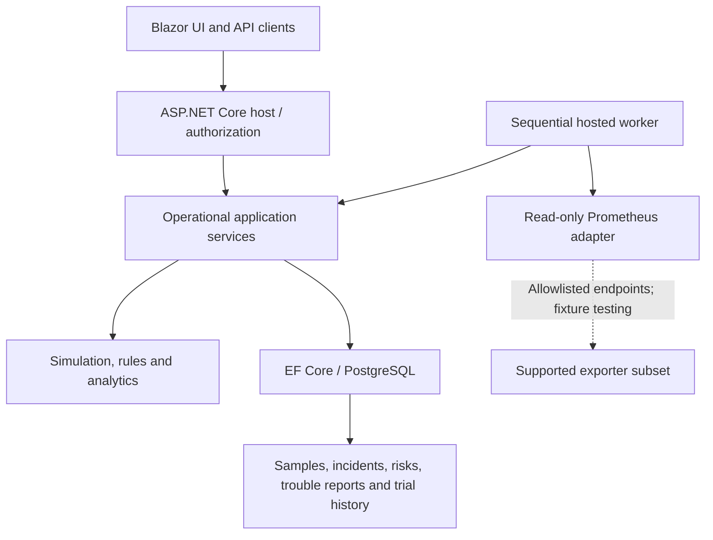

# Architecture and Engineering Decisions

AI_Infra is implemented as a **.NET 10 modular monolith** with a separately layered core, infrastructure and web application.

| Layer | Responsibility |
| --- | --- |
| `Platform.Core` | Assets/measurements, deterministic simulation, incident rules, analytics and improvement calculations |
| `Platform.Infrastructure` | PostgreSQL with EF Core/Npgsql, telemetry adapters, durable incident/program/improvement workflows, reports |
| `Platform.Web` | Blazor Interactive Server UI, ASP.NET Core APIs, ASP.NET Identity/roles and background worker |

## Design rationale

**Deterministic simulation.** Seeds and per-asset/tick noise make failure-path demonstrations reproducible without private compute infrastructure.

**Data origin and time semantics.** Measured, simulated and imported data retain provenance. The synthetic clock is distinct from UTC management-event time, and relevant calculations reject inappropriate source mixing or gaps.

**Evidence before remediation.** Rules preserve triggering measurements and timestamps. Correlation groups related alerts; cause remains an investigation hypothesis. No procedure runs automatically against equipment.

**Persistent improvement knowledge.** Trouble reports link incidents, equipment and technical programs. Procedure trials preserve version snapshots, and human-reviewed outcomes remain in the record. Reopened cases require evidence for the new cycle. Suggestions rely on transparent lexical matching, not trained AI diagnosis.

**Interpretable analysis.** OLS trends include chronological holdout error checks; under-supported exhaustion dates are withheld. MR(2) control limits are exploratory and do not imply production process capability.

**Small-deployment architecture.** A modular monolith plus PostgreSQL keeps transactions and debugging understandable. Distributed worker leases, tenant isolation, and large fleet throughput would need separate engineering validation before scaling.

## Technology

.NET SDK 10.0.402 / .NET runtime 10.0.13; C#; ASP.NET Core/Blazor; EF Core and Npgsql; PostgreSQL 17; Docker Compose; GitHub Actions/automated browser tests.

## Operational safeguards and limits

Implemented safeguards include Admin/Operator/Viewer roles, service/API authorization, CSRF protection for cookie writes, read-only demo restrictions and an exporter hostname allowlist. These are not a security certification.

A read-only Prometheus adapter supports a limited subset of exporter metrics under fixture testing; no physical GPU/server compatibility is claimed. Production deployment would require HTTPS, backup restore, operational identity management, source attribution checks and performance/security testing.

[Portfolio home](../README.md) · [Validation record](VALIDATION.md) · [Project status](PROJECT_STATUS.md)
