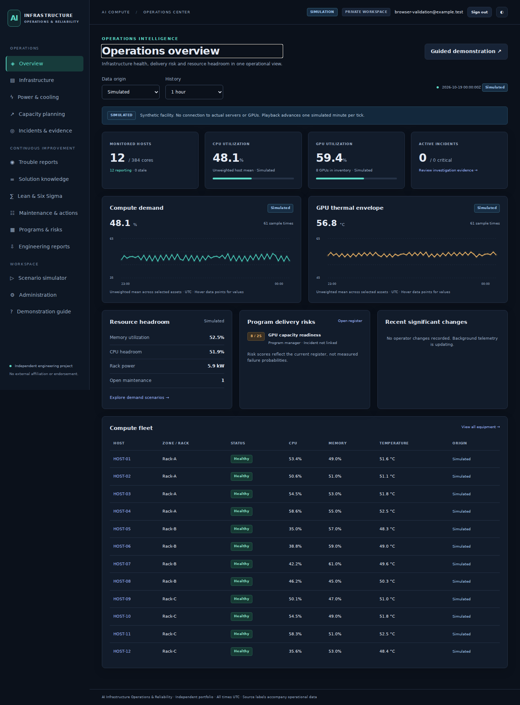
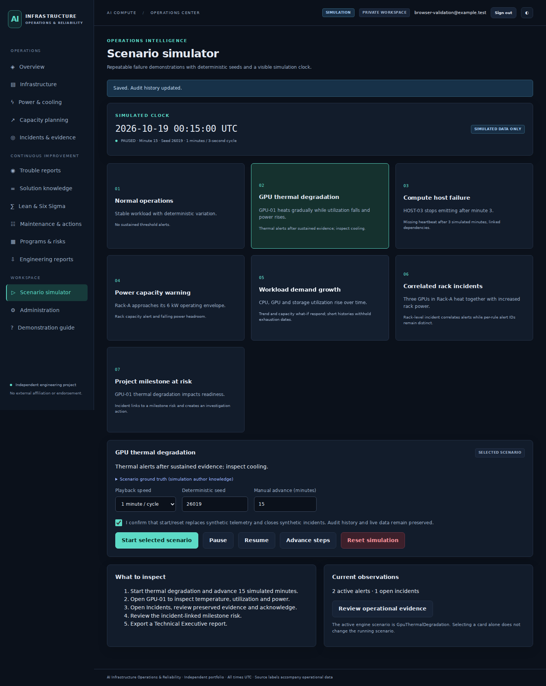
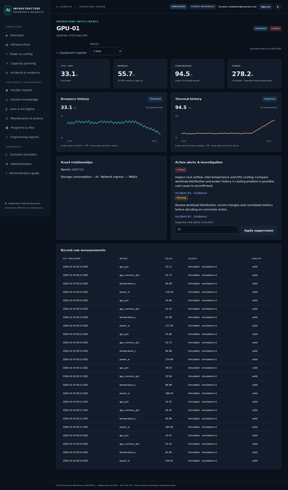
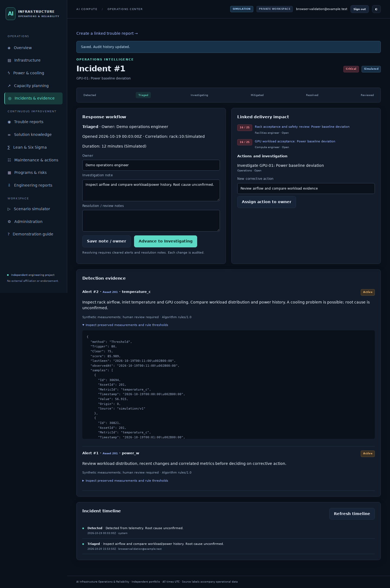
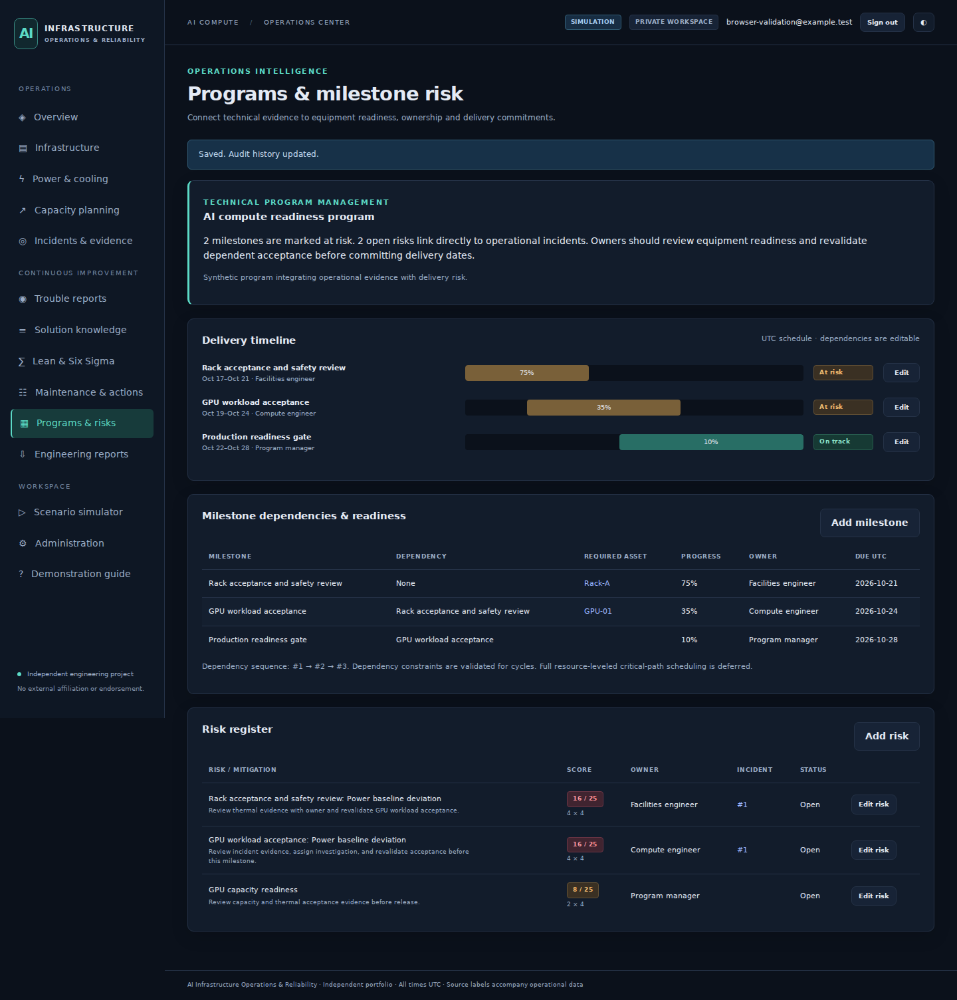
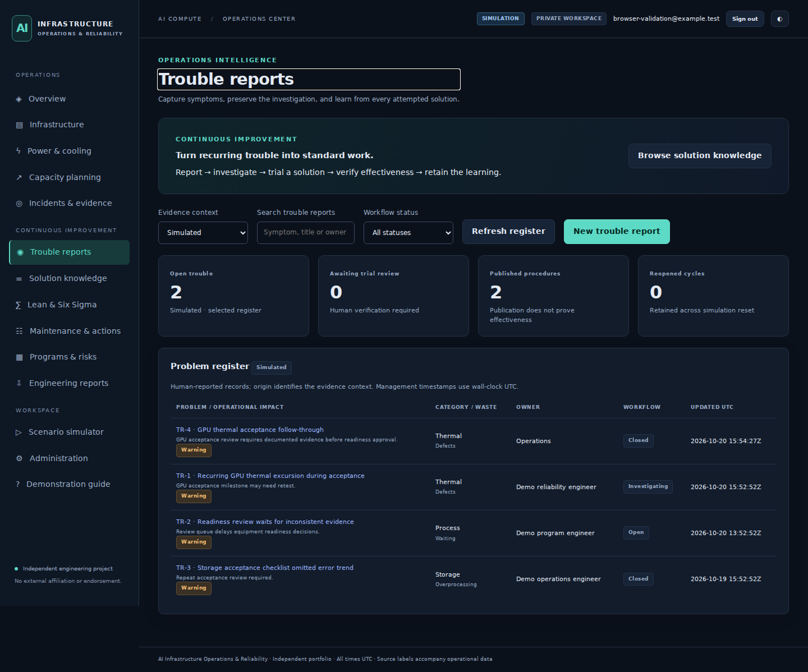
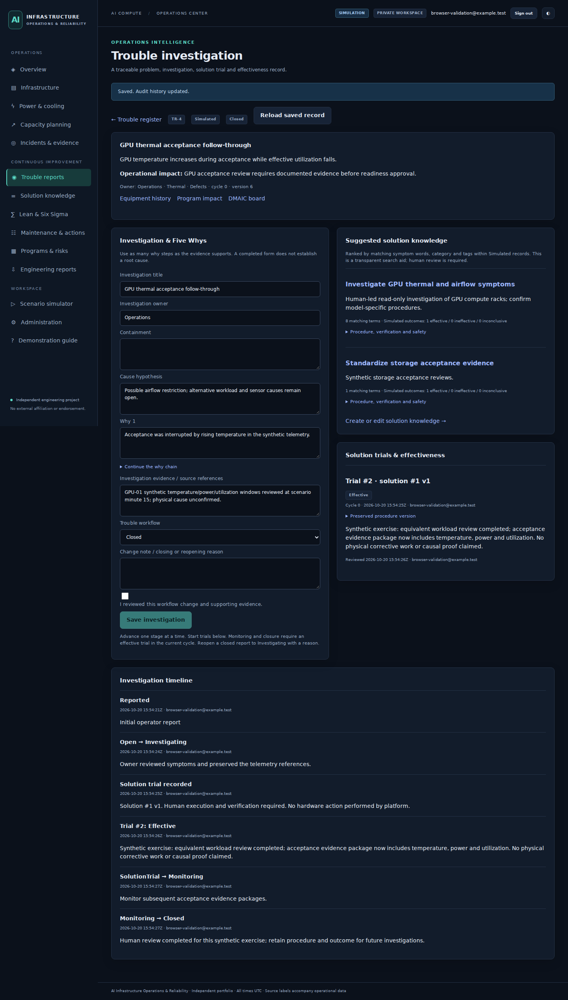
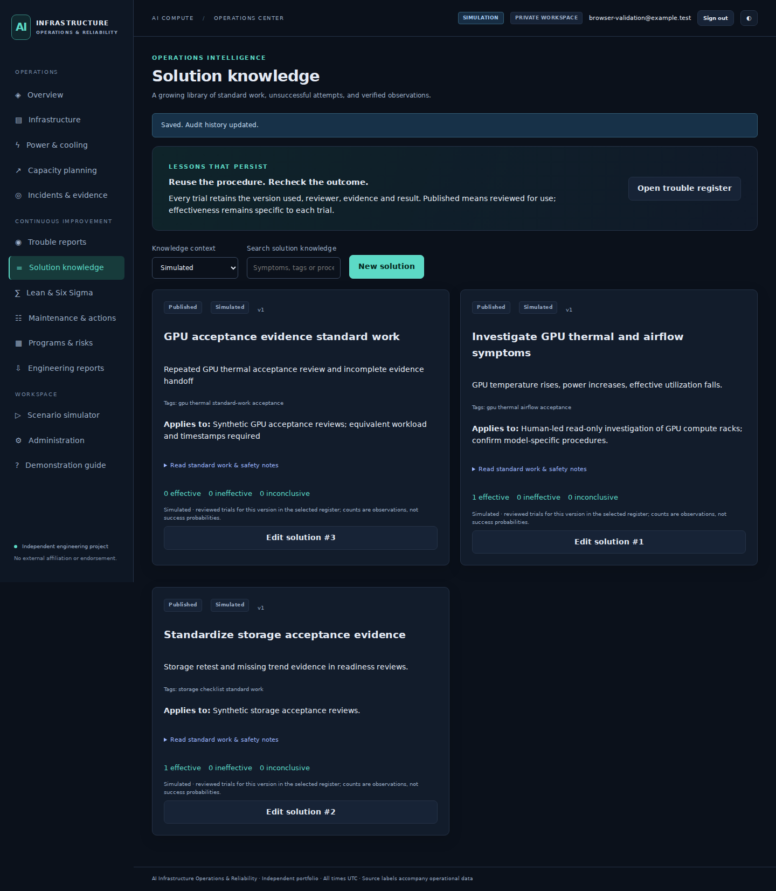
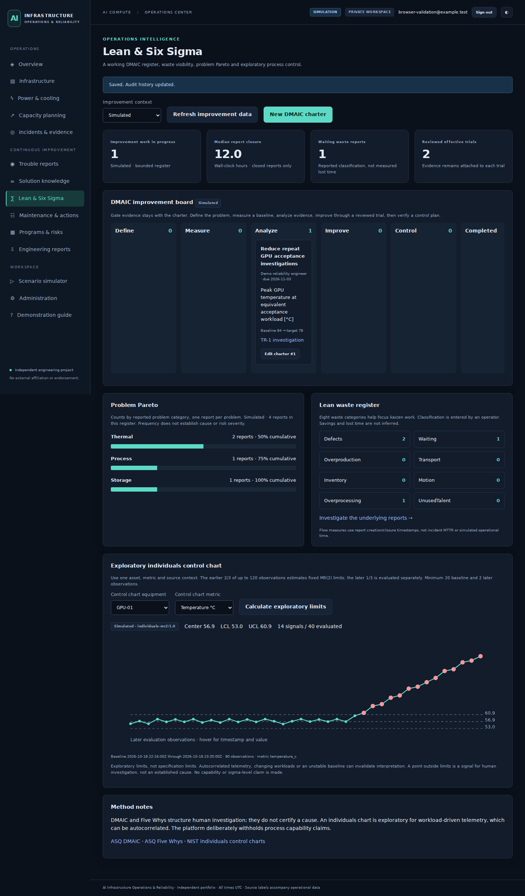
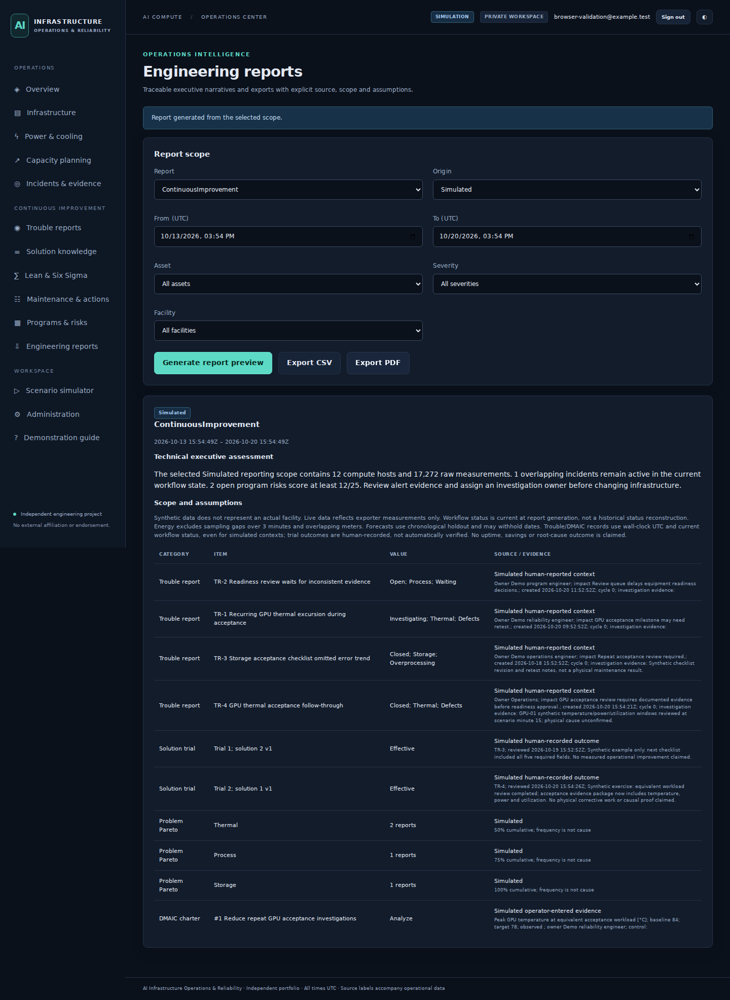

# Application Walkthrough

These ten screenshots were captured from the **compiled Blazor application running in a synthetic test workspace**. They are not mockups. Some captures display an `example.test` test-login identifier, not a real account.

## 1. Operations overview

Source-labeled compute status, utilization, resource headroom, program risk and recent operational context.

## 2. Scenario simulation

Seven operating/failure scenarios with deterministic seeds, playback and manual time stepping.

## 3. GPU evidence

Synthetic thermal rise, associated utilization/power change and source-aware measurement history.

## 4. Incident investigation

Preserved alert evidence, triage actions, ownership, corrective-action tracking and audit context.

## 5. Program readiness

Milestone dependencies and asset-readiness risks linked to incidents and human-reviewed mitigation.

## 6. Trouble-report register

Persistent categorized problem records, workflow status and equipment/program relationships.

## 7. Detailed investigation and trial

Five Whys, containment, cause hypothesis, documented evidence, version-preserved solution trials and reviewed outcomes.

## 8. Solution knowledge

Reusable human-readable standard work, applicability, verification and safety requirements.

## 9. Lean/Six Sigma workbench

DMAIC charters, CTQ measurement, waste/Pareto views and exploratory individuals control limits.

## 10. Engineering reporting

Traceable, source-scoped reporting and CSV/PDF exports for human review.

---

All operational scenarios pictured are synthetic. Trial outcomes are human-entered records; the platform does not prove physical repair effectiveness.

[Home](../README.md) · [Engineering case study](ENGINEERING_CASE_STUDY.md) · [Validation](VALIDATION.md)
